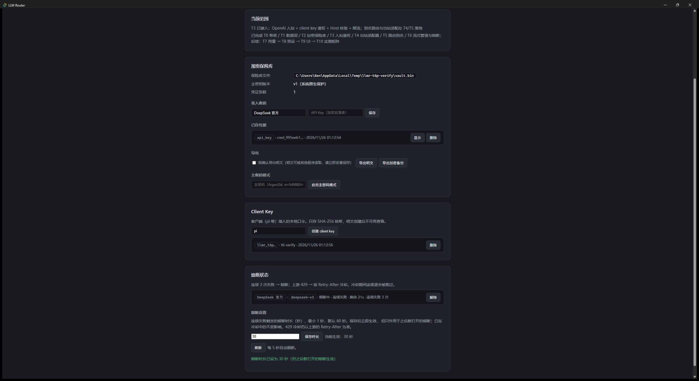
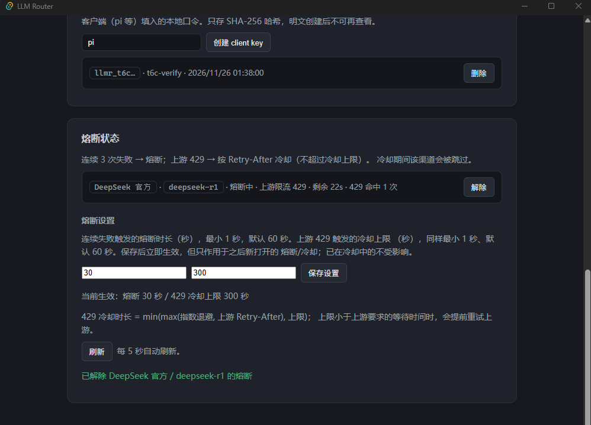

# T6 追加验收留档 — 熔断状态落库 + UI 展示 + 429/Retry-After 口径

| 项 | 值 |
|---|---|
| 任务 | T6 追加项（头头 2026-11-26 裁决 T6 留档 §6 的两条待裁决 + 追加两项） |
| 依据 | `docs/reviews/proposal-circuit-persistence.md`（提案与裁决）；02 §2.3 / §4.4 / §9 |
| 验收日期 | 2026-11-26 |
| 执行 | MiniMax Code（开发 agent） |
| 分支 | `dev` |
| 代码提交 | `a3809a2`（落库 + UI）、`56ecca9`（时长可配置 + 手动解除）、`96be851`（429 冷却上限可配） |
| 结论 | **通过**（判据逐条实测见 §1） |

## 1. 判据对照

| # | 判据 | 实测 | 证据 |
|---|---|---|---|
| 1 | **熔断状态落库** | ✅ | §2.3 真机：`circuit_state` 落 1 行（`open` / `failures`） |
| 2 | **重启后恢复**（不再绕过限流） | ✅ | §2.3 真机：重启应用后请求**不再打上游**，错误仍说明熔断 |
| 3 | **回到 closed 自动清理**落库行 | ✅ | §2.2 单测 + §2.3 真机 |
| 4 | **UI 展示**（状态/原因/剩余秒数） | ✅ | §2.4 真机截图（重启后仍显示"熔断中 · 剩余 55s"） |
| 5 | 未达阈值的失败**不落库** | ✅ | §2.2 单测 + §2.3 真机（前 2 次失败时表为空） |
| 6 | 迁移 v5 可升可降 | ✅ | §2.2（迁移 up/down 断言） |
| 7 | 限流冷却期回 **429 + `Retry-After`**（口径回填 02 §4.4） | ✅ | T6 主留档 §2.4 已实测；本次补文档回填 |
| 8 | **手动解除熔断**（UI 按钮 → 清内存 + 删落库行） | ✅ | §2.5 真机：点一次按钮，落库行即被删除，后续请求重新打到上游 |
| 9 | **熔断时长可配置**（默认 60s / 最小 1s / 秒级） | ✅ | §2.5 真机：UI 改 30 秒 → 落库 → 立即生效（新熔断只剩 29s 而非 60s） |
| 10 | **429 冷却上限可配置**（默认 60s / 最小 1s / 秒级） | ✅ | §2.7 真机：上限 10s 时上游 `Retry-After: 30` 被截断为 **10**；UI 改 300s 后不再截断（回 **30**） |

## 2. 实测记录

### 2.1 测试

```
$ cd src-tauri && cargo test
test result: ok. 180 passed; 0 failed; 0 ignored; 0 measured; 0 filtered out   # 单元测试
test result: ok. 5 passed;  0 failed; 1 ignored                                 # tests/gateway_e2e.rs
test result: ok. 6 passed;  0 failed; 0 ignored                                 # tests/outbound_e2e.rs（T4）
test result: ok. 11 passed; 0 failed; 0 ignored                                 # tests/router_e2e.rs（T5）
test result: ok. 13 passed; 0 failed; 0 ignored                                 # tests/stream_e2e.rs（T6）
test result: ok. 3 passed;  0 failed; 1 ignored                                 # tests/vault_e2e.rs（T2）
```

编译告警：0。前端 `npm run build` 通过（`tsc && vite build`，21 modules transformed）。

> 单元测试 147 → 162（+15：熔断持久化 6 + 落库实现 5 + IPC 命令层 4）→ 173（+11：熔断时长与手动解除）→ **180**（+7：429 冷却上限）。全量 **218** 项。

### 2.2 新增用例

| 层 | 用例 | 断言要点 |
|---|---|---|
| 单测 | `opening_the_circuit_is_written_through` | 未达阈值不落库；第 3 次失败写穿 1 行（`open` / `failures` / `open_until` 正确） |
| 单测 | `success_removes_the_persisted_row` | 回到 closed → 删除落库行（且**只有**这一条删除，不产生噪声 DELETE） |
| 单测 | `rate_limit_is_persisted_with_its_reason` | 429 落库带 `reason=rate_limit` 与冷却截止 |
| 单测 | `state_is_restored_on_startup` | 新建熔断器读回落库行 → 冷却期内仍拦截；到期放行一次探测 |
| 单测 | `active_snapshots_only_list_non_closed_circuits` | UI 列表只含非 closed 的熔断 |
| 单测 | `save_and_load_round_trip` / `save_is_upsert_not_insert` / `remove_deletes_the_row` / `deleted_channel_clears_its_circuit_rows` / `load_all_on_empty_table_returns_empty` | 落库实现：往返、覆盖写、删除、渠道删除级联清理、空表 |
| 单测 | `empty_state_lists_nothing` / `open_circuit_is_listed_with_channel_name_and_reason` / `rate_limit_circuit_is_listed_with_rate_limit_reason` / `closed_circuit_is_not_listed` | IPC 命令层：渠道名回填、原因与剩余秒数、closed 不展示 |
| e2e | `acceptance_circuit_state_is_persisted_and_survives_restart` | 前 2 次失败不落库；第 3 次落库 1 行；**用同一个库新建熔断器 → 仍在拦截**（模拟重启） |
| e2e | `acceptance_circuit_row_is_removed_after_recovery` | 一次成功 → 回到 closed → 落库行被清理 |

### 2.3 真机 HTTP 验收（应用实跑，`127.0.0.1:8787`）

应用以**独立数据目录**启动（`LLMR_STORE_PATH` / `LLMR_VAULT_PATH` 指向临时目录，不污染用户真实库）：

```
[store] 数据库 C:\Users\Ben\AppData\Local\Temp\llmr-t6p-verify\store.db（schema v5）
[vault] 保险库 C:\Users\Ben\AppData\Local\Temp\llmr-t6p-verify\vault.bin（主密钥 v1）
[gateway] 监听 http://127.0.0.1:8787/v1（OpenAI 兼容入站）
```

**阶段 1（熔断 → 落库）**

```
[PASS] 前 3 次失败：都打到上游并返回 502: 状态码=[502, 502, 502] mock 计数 0 → 3
[PASS] 熔断状态已落库（circuit_state 1 行）: circuit_state 行数=1 内容=[('ch_baeb...', 'deepseek-v3', 'open', 'failures', 3, 0, 1795626843)]
[PASS] 落库内容正确（state=open / reason=failures）: 行=('ch_baeb...', 'deepseek-v3', 'open', 'failures', 3, 0, 1795626843)
ALL_PASS
```

**阶段 2（重启应用 → 仍拦截）**

```
[PASS] 落库行仍在（重启未丢）: circuit_state=[('ch_baeb...', 'deepseek-v3', 'open', 'failures', 3, 0, 1795626843)]
[PASS] 重启后仍处于熔断：请求不再打上游: mock 计数 3 → 3（HTTP=502）
[PASS] 重启后仍处于熔断：错误信息说明熔断: HTTP 502 message='没有可用候选：全部候选被跳过或熔断中'
ALL_PASS
```

**半开探测（冷却到期后）**：重启后等冷却到期再发一次请求 → 放行一次探测（mock 计数 +1）→ 探测失败 → 熔断**重新打开** 60s（库中 `open_until` 刷新为 `now+60`）。状态机三态在真机上完整走通。

### 2.4 UI 真机验证（截图）

调试版 app 需要 Vite dev server（`tauri.conf.json` 的 `devUrl` = `http://localhost:1420`）才能渲染前端；`cargo build` 的调试二进制不带 `custom-protocol` 特性，会直接去连 1420 端口。起 `npm run dev` 后：


面板内容（重启后恢复的落库状态）：

```
熔断状态
连续 3 次失败 → 熔断 60s；上游 429 → 按 Retry-After 冷却。冷却期间该渠道会被跳过。
DeepSeek 官方 · deepseek-v3 · 熔断中 · 连续失败 · 剩余 55s · 连续失败 3 次
[刷新]  每 5 秒自动刷新。
```

同一张截图里还能看到：网关状态（运行中 / `127.0.0.1:8787`）、当前范围（T0–T6 已完成）、加密保险库（`llmr-t6p-verify` 独立库、1 条凭证）、Client Key 面板。

### 2.5 手动解除 + 熔断时长设置（真机点击验证）

UI 面板（`docs/reviews/app-ui-circuit-settings.png`）：



**手动解除**（真的用鼠标点了一次按钮）：

```
=== 点击前 circuit_state ===
[('ch_baeb...', 'deepseek-v3', 'open', 'failures', 3)]
CLICKED 1584,1094          # 「解除」按钮的屏幕坐标
=== 点击后 circuit_state ===
[]                          # 落库行被删除
```

界面随即显示绿色提示"已解除 DeepSeek 官方 / deepseek-v3 的熔断"，列表变为"当前没有渠道处于熔断或冷却中"；随后发一次请求，报错从"没有可用候选：全部候选被跳过或熔断中"变成"连接上游失败: …"——**说明请求重新打到了上游，熔断确实被解除了**。

**熔断时长设置**（UI 输入框改成 30 秒并点"保存时长"）：

```
=== app_setting ===
[('circuit_open_secs', '30', 1795627768)]     # 已落库
```

随后连续 3 次失败触发新熔断：

```
circuit_state: [('open', 'failures', 3, 1795627811)]
now= 1795627782 → 剩余秒数= 29              # 30s 生效（默认应为 60s）
```

界面显示"当前生效：30 秒"与绿色提示"熔断时长已设为 30 秒（对之后新打开的熔断生效）"。

### 2.6 新增用例（时长与解除）

| 层 | 用例 | 断言要点 |
|---|---|---|
| 单测 | `open_duration_is_configurable` | 默认 60s；改成 120s 后新熔断的 `open_until = now+120` |
| 单测 | `open_duration_is_clamped_to_one_second` | 0 与负值都钳到 1 秒（最小单位 1 秒） |
| 单测 | `changing_duration_does_not_retroactively_change_open_circuits` | 已在冷却中的熔断不被新设置追溯修改 |
| 单测 | `settings_default_to_sixty_seconds` | 未设置时返回默认 60 |
| 单测 | `settings_are_persisted_and_applied_immediately` | 写设置 → 落库 + 运行时立即生效 → 再读一致 |
| 单测 | `settings_below_one_second_are_clamped` | 0 / -5 → 1 |
| 单测 | `manual_reset_clears_circuit_and_its_row` | 手动解除 → 列表清空 + `circuit_state` 行数归零 |
| 单测 | `manual_reset_on_healthy_circuit_reports_nothing_to_clear` | 健康渠道调用返回 false |
| 单测 | `setting_round_trip` / `setting_is_overwritten_not_duplicated` / `invalid_integer_falls_back_to_none` | `app_setting` 读写与覆盖 |
| 迁移 | `migrate_down_to_rolls_back_partially` | 回滚版本 6/5/4/3；`app_setting` 表随 v6 一并回滚 |

### 2.7 真机验收：429 冷却上限（裁决五）

上游 mock 新增 `/fail429long` 场景：固定回 **429 + `Retry-After: 30`**（模拟"上游要求等很久"）。网关侧把渠道指到该场景。

**阶段 A：上限 10s → 应截断上游的 30s**

```
[PASS] 上游 429 已透传到客户端（HTTP 429）: HTTP=429 body='{"error":{"message":"上游 DeepSeek 官方 限流（429），冷却 10s","type":"rate_limit_error","channel":"DeepSeek 官方","retried":["DeepSeek 官方"]}}'
[PASS] 请求确实打到了上游: mock fail429long 计数 0 → 1
[PASS] 回给客户端的 Retry-After 是**实际生效**值（10），不是上游的 30: Retry-After='10'（上游原始 30，被用户上限 10 截断）
[PASS] 错误信息里的冷却秒数与实际生效值一致: body='...冷却 10s...'
[PASS] 429 冷却已落库（reason=rate_limit）: circuit_state=[('ch_baeb...', 'deepseek-r1', 'open', 'rate_limit', 0, 1, 1795628303)]
[PASS] 落库的冷却截止时间约等于 now+10: open_until-now=9s
[PASS] 冷却期内请求被挡住（不再打上游）: mock fail429long 计数 1 → 1（HTTP=429）
[PASS] 冷却期内仍回 429 + Retry-After: HTTP=429 Retry-After='9'
[PASS] 冷却到期后重新放行（再次打到上游）: mock fail429long 计数 1 → 2（HTTP=429）
[PASS] 重新触发后 Retry-After 仍受上限约束（10）: Retry-After='10'
ALL_PASS
```

三个关键点都在这组结果里：**回给客户端的 `Retry-After` 是实际生效值（10）而不是上游原始值（30）**；冷却期内**不会重复打上游**；冷却到期后**重新放行**（不是永久封死）。

**重启复验**（`app_setting` 落库 → 启动读回）：重启应用后同一套 10 项再次 `ALL_PASS`（mock 计数 2 → 3，`Retry-After` 仍为 10），证明上限是**持久化**的、重启不丢。

**阶段 B：UI 把上限改成 300s → 应完整尊重上游的 30s**

真的用鼠标点了一次「保存设置」：点第二个输入框 → 全选 → 输入 `300` → 点「保存设置」。

```
=== app_setting ===
[('circuit_open_secs', '30'), ('rate_limit_cooldown_cap_secs', '300')]
```

界面随即显示绿色提示「已保存：熔断时长 30 秒，429 冷却上限 300 秒（对之后新打开的熔断/冷却生效）」与「当前生效：熔断 30 秒 / 429 冷却上限 300 秒」。

点「解除」清掉上一轮的 429 计数（`circuit_state` 行归零）后发请求：

```
[PASS] 上游 429 已透传到客户端（HTTP 429）: HTTP=429 body='{"error":{"message":"上游 DeepSeek 官方 限流（429），冷却 30s",...}}'
[PASS] 请求确实打到了上游: mock fail429long 计数 4 → 5
[PASS] 上限足够大时尊重上游 Retry-After（30）: Retry-After='30'（上游 30，未被截断）
[PASS] 冷却期内请求被挡住（不再打上游）: mock fail429long 计数 5 → 5（HTTP=429）
[PASS] 冷却期内仍回 429 + Retry-After: HTTP=429 Retry-After='30'
ALL_PASS
```

→ 同一个上游、同一个 `Retry-After: 30`，**上限 10s 时回 10、上限 300s 时回 30**，上限确实是活的旋钮。



面板同时可见：429 冷却行（`熔断中 · 上游限流 429 · 剩余 22s · 429 命中 1 次`）、两个输入框（熔断 30 / 冷却上限 300）、公式说明，以及「解除」按钮。

### 2.8 新增用例（429 冷却上限）

| 层 | 用例 | 断言要点 |
|---|---|---|
| 单测 | `rate_limit_backoff_respects_a_smaller_cap` | 上限 10s 时退避封顶在 10（不是 60） |
| 单测 | `rate_limit_cap_is_configurable_and_clamped` | 默认 60s；0 / 负值钳到 1 秒 |
| 单测 | `rate_limit_cap_truncates_a_longer_retry_after` | 上限 10s + 上游 `Retry-After: 30` → 生效冷却 **10**，`open_until = now+10` |
| 单测 | `rate_limit_cap_does_not_extend_a_shorter_retry_after` | 上限 300s + 上游 1s + 退避 2s → 生效冷却 **2**（上限只截断、不放大） |
| 单测 | `rate_limit_cap_also_bounds_the_exponential_backoff` | 连续 429 时退避涨到 8s/16s，但被上限 5s 压住 → 生效冷却 **5** |
| 单测 | `rate_limit_returns_the_effective_cooldown` | `on_rate_limited` 返回**生效**秒数：未设上限回 30，设上限 10 回 10 |
| 单测 | `rate_limit_cap_setting_truncates_upstream_retry_after` | 命令层：设置落库 + 运行时立即生效 → `on_rate_limited` 回 10 |
| 单测（改） | `rate_limit_uses_exponential_backoff` | 签名改为 `rate_limit_backoff(hits, cap)`；默认上限下仍是 2/4/8/16/32/60 |
| 单测（改） | `settings_default_to_sixty_seconds` / `settings_are_persisted_and_applied_immediately` / `settings_below_one_second_are_clamped` | 新增 `rate_limit_cooldown_cap_secs` 的默认值 / 落库 / 钳位断言 |

单元测试 173 → **180**（+7），全量 **218** 项（180 单元 + 5 网关 + 6 出站 + 11 路由 + 13 流式 + 3 保险库）0 失败，编译告警 0。

## 3. 本次交付物

| 路径 | 说明 |
|---|---|
| `src-tauri/src/store/schema.rs` | `CIRCUIT_STATE_DDL`、`APP_SETTING_DDL` + `ALL_TABLES` 增项（DDL 唯一权威载体） |
| `src-tauri/src/store/migrations.rs` | v5 `circuit_state`、v6 `app_setting` 迁移（均可 up 可 down） |
| `src-tauri/src/store/settings.rs` | 应用级设置读写（键值对；`circuit_open_secs`、`rate_limit_cooldown_cap_secs`） |
| `src-tauri/src/gateway/circuit.rs` | `CircuitSnapshot` / `CircuitStateKind` / `OpenReason`（字符串互转）、`CircuitPersistence` trait、`NoopPersistence`、写穿 + 启动恢复、`active_snapshots`、**熔断时长运行期可调**（`set_open_duration_secs`）、**429 冷却上限运行期可调**（`set_rate_limit_cap_secs`）、`on_rate_limited` 返回**实际生效**冷却秒数 |
| `src-tauri/src/gateway/circuit_store.rs` | 基于 `Store` 的持久化实现（upsert / delete / load_all），落库失败只记日志 |
| `src-tauri/src/gateway/fallback.rs` | `circuit_key` 迁到 `circuit.rs`（单一来源），此处改为 re-export；429 分支用**生效冷却**填错误信息与 `Retry-After` |
| `src-tauri/src/commands/circuit.rs` | `circuit_status` IPC（拆出可测的 `circuit_status_of`）+ **`circuit_settings_get` / `circuit_settings_set`（两项）/ `circuit_reset`** |
| `src-tauri/src/lib.rs` | 构造带持久化的熔断器；`AppState` 增加 `circuit` 字段；**启动读回落库的熔断时长与 429 冷却上限**；注册新 IPC |
| `src/CircuitPanel.tsx` | 熔断状态面板（5s 自动刷新 + 手动刷新）+ **每条记录的「解除」按钮** + **「熔断设置」（熔断时长 + 429 冷却上限两个秒级输入 + 保存）** |
| `src/App.tsx` | 挂载 `<CircuitPanel />`；范围说明更新到 T6 |
| `src-tauri/tests/stream_e2e.rs` | 2 个新增 e2e（落库 + 重启恢复 + 恢复后清理） |
| `docs/planning/02-technical-design.md` | §2.3 持久化口径、§4.4 429/`Retry-After` 回填、§9 `circuit_state` DDL、§13 → v0.3 |
| `docs/planning/03-delivery-plan.md` | T6 任务卡追加一行（本次追加范围） |
| `docs/reviews/proposal-circuit-persistence.md` | 提案与裁决记录（两项决策的取舍与影响） |

无新增依赖。

## 4. 设计取舍与遗留

| 项 | 说明 |
|---|---|
| **写穿（状态一变即写），不做定时快照** | 快照会有"内存与库不一致"的窗口；写穿没有额外一致性成本 |
| **只落库非 closed** | 表里天然只反映"正在冷却的渠道"，不会无限增长；回到正常自动清理 |
| **仅在落库载荷真的变化时才写** | closed 状态下的一次成功、或未达阈值的失败，**不产生任何数据库写**——否则每个成功请求都会打一条 DELETE |
| **失败计数不落库** | 未达阈值的 1~2 次失败本来就该放行，落库没有价值；重启后清零 |
| **落库失败只记日志，不影响请求** | 熔断状态丢失只是重新计数，不能让请求失败 |
| **UI 读运行中的熔断器（不查库）** | 库是持久化副本，运行时真相在内存；查库会滞后 |
| **重启恢复的语义** | 恢复的是"冷却截止时间"，不是"重新计时"——重启不会延长冷却，也不会绕过它 |
| 手动解除熔断 | **已实现**（§2.5）：`circuit_reset` 清内存状态 + 删落库行（重启不复活）；按 `(channel, upstream_model)` 粒度，不做"一键全解" |
| 熔断时长 | **可配置**（§2.5）：默认 60s、最小 1 秒，存 `app_setting` 表；立即生效但**不追溯**已在冷却中的熔断 |
| 429 冷却时长 | **可配置上限**（§2.7）：默认 60s、最小 1 秒，存 `app_setting.rate_limit_cooldown_cap_secs`；冷却 = `min(max(退避, Retry-After), 上限)`；上限可**缩短**上游要求的等待（调大即可完整尊重 `Retry-After`）；回给客户端的 `Retry-After` 是**实际生效值** |
| 熔断历史的趋势视图 | **未做**（只存当前状态，不存历史）；要做历史需另立表，属 T13 用量统计范围 |
| 账号级熔断 | 粒度仍是 `(channel_id, upstream_model)`，不是 `(channel, account)`——账号池尚未落地（T8/T9） |

## 5. 未做

- 熔断历史的趋势视图、解除操作的审计记录 —— T7 / T13
- 账号级（多凭证）熔断粒度 —— T8/T9 账号池落地后
- 熔断状态的跨设备同步（v1 纯本地，不做云同步）—— 02 §12
- 上游 `Retry-After` 的 HTTP-date 形式解析（只认秒数形式）—— 解析不了时退化为纯指数退避
