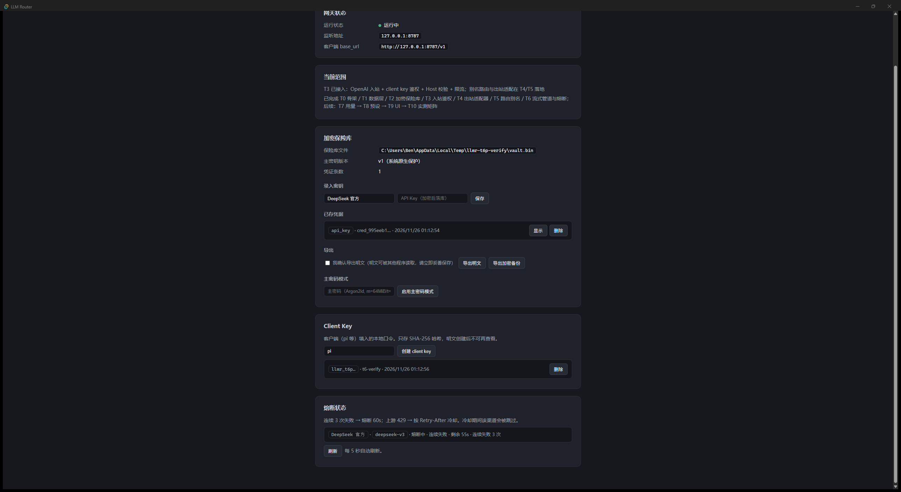

# T6 追加验收留档 — 熔断状态落库 + UI 展示 + 429/Retry-After 口径

| 项 | 值 |
|---|---|
| 任务 | T6 追加项（头头 2026-11-26 裁决 T6 留档 §6 的两条待裁决） |
| 依据 | `docs/reviews/proposal-circuit-persistence.md`（提案与裁决）；02 §2.3 / §4.4 / §9 |
| 验收日期 | 2026-11-26 |
| 执行 | MiniMax Code（开发 agent） |
| 分支 | `dev` |
| 代码提交 | `a3809a2` |
| 结论 | **通过**（判据逐条实测见 §1） |

## 1. 判据对照

| # | 判据 | 实测 | 证据 |
|---|---|---|---|
| 1 | **熔断状态落库** | ✅ | §2.3 真机：`circuit_state` 落 1 行（`open` / `failures`） |
| 2 | **重启后恢复**（不再绕过限流） | ✅ | §2.3 真机：重启应用后请求**不再打上游**，错误仍说明熔断 |
| 3 | **回到 closed 自动清理**落库行 | ✅ | §2.2 单测 + §2.3 真机 |
| 4 | **UI 展示**（状态/原因/剩余秒数） | ✅ | §2.4 真机截图（重启后仍显示"熔断中 · 剩余 55s"） |
| 5 | 未达阈值的失败**不落库** | ✅ | §2.2 单测 + §2.3 真机（前 2 次失败时表为空） |
| 6 | 迁移 v5 可升可降 | ✅ | §2.2（迁移 up/down 断言） |
| 7 | 限流冷却期回 **429 + `Retry-After`**（口径回填 02 §4.4） | ✅ | T6 主留档 §2.4 已实测；本次补文档回填 |

## 2. 实测记录

### 2.1 测试

```
$ cd src-tauri && cargo test
test result: ok. 162 passed; 0 failed; 0 ignored; 0 measured; 0 filtered out   # 单元测试
test result: ok. 5 passed;  0 failed; 1 ignored                                 # tests/gateway_e2e.rs
test result: ok. 6 passed;  0 failed; 0 ignored                                 # tests/outbound_e2e.rs（T4）
test result: ok. 11 passed; 0 failed; 0 ignored                                 # tests/router_e2e.rs（T5）
test result: ok. 13 passed; 0 failed; 0 ignored                                 # tests/stream_e2e.rs（T6）
test result: ok. 3 passed;  0 failed; 1 ignored                                 # tests/vault_e2e.rs（T2）
```

编译告警：0。前端 `npm run build` 通过（`tsc && vite build`，21 modules transformed）。

> 单元测试 147 → 162（+15）：熔断持久化 6 + 落库实现 5 + IPC 命令层 4。

### 2.2 新增用例

| 层 | 用例 | 断言要点 |
|---|---|---|
| 单测 | `opening_the_circuit_is_written_through` | 未达阈值不落库；第 3 次失败写穿 1 行（`open` / `failures` / `open_until` 正确） |
| 单测 | `success_removes_the_persisted_row` | 回到 closed → 删除落库行（且**只有**这一条删除，不产生噪声 DELETE） |
| 单测 | `rate_limit_is_persisted_with_its_reason` | 429 落库带 `reason=rate_limit` 与冷却截止 |
| 单测 | `state_is_restored_on_startup` | 新建熔断器读回落库行 → 冷却期内仍拦截；到期放行一次探测 |
| 单测 | `active_snapshots_only_list_non_closed_circuits` | UI 列表只含非 closed 的熔断 |
| 单测 | `save_and_load_round_trip` / `save_is_upsert_not_insert` / `remove_deletes_the_row` / `deleted_channel_clears_its_circuit_rows` / `load_all_on_empty_table_returns_empty` | 落库实现：往返、覆盖写、删除、渠道删除级联清理、空表 |
| 单测 | `empty_state_lists_nothing` / `open_circuit_is_listed_with_channel_name_and_reason` / `rate_limit_circuit_is_listed_with_rate_limit_reason` / `closed_circuit_is_not_listed` | IPC 命令层：渠道名回填、原因与剩余秒数、closed 不展示 |
| e2e | `acceptance_circuit_state_is_persisted_and_survives_restart` | 前 2 次失败不落库；第 3 次落库 1 行；**用同一个库新建熔断器 → 仍在拦截**（模拟重启） |
| e2e | `acceptance_circuit_row_is_removed_after_recovery` | 一次成功 → 回到 closed → 落库行被清理 |

### 2.3 真机 HTTP 验收（应用实跑，`127.0.0.1:8787`）

应用以**独立数据目录**启动（`LLMR_STORE_PATH` / `LLMR_VAULT_PATH` 指向临时目录，不污染用户真实库）：

```
[store] 数据库 C:\Users\Ben\AppData\Local\Temp\llmr-t6p-verify\store.db（schema v5）
[vault] 保险库 C:\Users\Ben\AppData\Local\Temp\llmr-t6p-verify\vault.bin（主密钥 v1）
[gateway] 监听 http://127.0.0.1:8787/v1（OpenAI 兼容入站）
```

**阶段 1（熔断 → 落库）**

```
[PASS] 前 3 次失败：都打到上游并返回 502: 状态码=[502, 502, 502] mock 计数 0 → 3
[PASS] 熔断状态已落库（circuit_state 1 行）: circuit_state 行数=1 内容=[('ch_baeb...', 'deepseek-v3', 'open', 'failures', 3, 0, 1795626843)]
[PASS] 落库内容正确（state=open / reason=failures）: 行=('ch_baeb...', 'deepseek-v3', 'open', 'failures', 3, 0, 1795626843)
ALL_PASS
```

**阶段 2（重启应用 → 仍拦截）**

```
[PASS] 落库行仍在（重启未丢）: circuit_state=[('ch_baeb...', 'deepseek-v3', 'open', 'failures', 3, 0, 1795626843)]
[PASS] 重启后仍处于熔断：请求不再打上游: mock 计数 3 → 3（HTTP=502）
[PASS] 重启后仍处于熔断：错误信息说明熔断: HTTP 502 message='没有可用候选：全部候选被跳过或熔断中'
ALL_PASS
```

**半开探测（冷却到期后）**：重启后等冷却到期再发一次请求 → 放行一次探测（mock 计数 +1）→ 探测失败 → 熔断**重新打开** 60s（库中 `open_until` 刷新为 `now+60`）。状态机三态在真机上完整走通。

### 2.4 UI 真机验证（截图）

调试版 app 需要 Vite dev server（`tauri.conf.json` 的 `devUrl` = `http://localhost:1420`）才能渲染前端；`cargo build` 的调试二进制不带 `custom-protocol` 特性，会直接去连 1420 端口。起 `npm run dev` 后：



面板内容（重启后恢复的落库状态）：

```
熔断状态
连续 3 次失败 → 熔断 60s；上游 429 → 按 Retry-After 冷却。冷却期间该渠道会被跳过。
DeepSeek 官方 · deepseek-v3 · 熔断中 · 连续失败 · 剩余 55s · 连续失败 3 次
[刷新]  每 5 秒自动刷新。
```

同一张截图里还能看到：网关状态（运行中 / `127.0.0.1:8787`）、当前范围（T0–T6 已完成）、加密保险库（`llmr-t6p-verify` 独立库、1 条凭证）、Client Key 面板。

## 3. 本次交付物

| 路径 | 说明 |
|---|---|
| `src-tauri/src/store/schema.rs` | `CIRCUIT_STATE_DDL` + `ALL_TABLES` 增项（DDL 唯一权威载体） |
| `src-tauri/src/store/migrations.rs` | v5 迁移 `circuit_state`（up 建表 / down 删表） |
| `src-tauri/src/gateway/circuit.rs` | `CircuitSnapshot` / `CircuitStateKind` / `OpenReason`（字符串互转）、`CircuitPersistence` trait、`NoopPersistence`、写穿 + 启动恢复、`active_snapshots` |
| `src-tauri/src/gateway/circuit_store.rs` | 基于 `Store` 的持久化实现（upsert / delete / load_all），落库失败只记日志 |
| `src-tauri/src/gateway/fallback.rs` | `circuit_key` 迁到 `circuit.rs`（单一来源），此处改为 re-export |
| `src-tauri/src/commands/circuit.rs` | `circuit_status` IPC（拆出可测的 `circuit_status_of`） |
| `src-tauri/src/lib.rs` | 构造带持久化的熔断器；`AppState` 增加 `circuit` 字段 |
| `src/CircuitPanel.tsx` | 熔断状态面板（5s 自动刷新 + 手动刷新） |
| `src/App.tsx` | 挂载 `<CircuitPanel />`；范围说明更新到 T6 |
| `src-tauri/tests/stream_e2e.rs` | 2 个新增 e2e（落库 + 重启恢复 + 恢复后清理） |
| `docs/planning/02-technical-design.md` | §2.3 持久化口径、§4.4 429/`Retry-After` 回填、§9 `circuit_state` DDL、§13 → v0.3 |
| `docs/planning/03-delivery-plan.md` | T6 任务卡追加一行（本次追加范围） |
| `docs/reviews/proposal-circuit-persistence.md` | 提案与裁决记录（两项决策的取舍与影响） |

无新增依赖。

## 4. 设计取舍与遗留

| 项 | 说明 |
|---|---|
| **写穿（状态一变即写），不做定时快照** | 快照会有"内存与库不一致"的窗口；写穿没有额外一致性成本 |
| **只落库非 closed** | 表里天然只反映"正在冷却的渠道"，不会无限增长；回到正常自动清理 |
| **仅在落库载荷真的变化时才写** | closed 状态下的一次成功、或未达阈值的失败，**不产生任何数据库写**——否则每个成功请求都会打一条 DELETE |
| **失败计数不落库** | 未达阈值的 1~2 次失败本来就该放行，落库没有价值；重启后清零 |
| **落库失败只记日志，不影响请求** | 熔断状态丢失只是重新计数，不能让请求失败 |
| **UI 读运行中的熔断器（不查库）** | 库是持久化副本，运行时真相在内存；查库会滞后 |
| **重启恢复的语义** | 恢复的是"冷却截止时间"，不是"重新计时"——重启不会延长冷却，也不会绕过它 |
| 手动解除熔断 | **未实现**（本次裁决只要求展示）；当前只能等冷却窗口自然到期（最长 60s）。属 T9 UI 第一轮范围 |
| 熔断历史趋势 | **未做**（只存当前状态，不存历史）；要做历史需另立表，属 T13 用量统计范围 |
| 账号级熔断 | 粒度仍是 `(channel_id, upstream_model)`，不是 `(channel, account)`——账号池尚未落地（T8/T9） |

## 5. 未做

- 手动解除熔断按钮、熔断历史的趋势视图 —— T9 / T13
- 账号级（多凭证）熔断粒度 —— T8/T9 账号池落地后
- 熔断状态的跨设备同步（v1 纯本地，不做云同步）—— 02 §12
